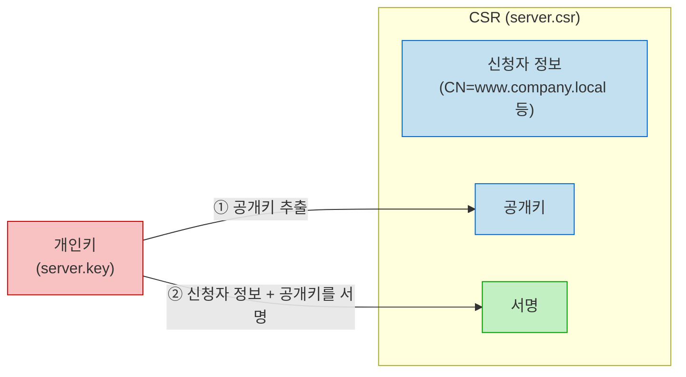

---
## OpenSSL이란?

OpenSSL은 **SSL/TLS 프로토콜과 각종 암호화 기능을 제공하는 오픈소스 라이브러리이자 CLI 도구**이다.

실무에서는 주로 다음 작업에 사용한다.

- 파일 암호화 / 복호화
- 개인키(Private Key) 생성
- CSR(인증서 서명 요청서) 생성
- 인증서(CRT) 발급 및 내용 확인

---
## 주요 명령어

---
### enc : 파일 암복호화

`enc`는 **대칭키 알고리즘으로 파일을 암호화하거나 복호화하는 명령어**이다.

**암호화**

```bash
openssl enc -aes256 -salt -pbkdf2 -in plain.txt -out enc.txt
```

**복호화**

```bash
openssl enc -d -aes256 -pbkdf2 -in enc.txt -out dec.txt
```

| 옵션        | 의미                                          |
| --------- | ------------------------------------------- |
| `-aes256` | 256비트 AES 알고리즘 사용                           |
| `-salt`   | 비밀번호에 Salt를 더해 암호화 강도를 높임                   |
| `-pbkdf2` | 비밀번호로부터 키를 만드는 방식으로 PBKDF2를 사용 (OpenSSL 1.1.1 이상) |
| `-d`      | 복호화 수행                                      |
| `-in`     | 입력 파일                                       |
| `-out`    | 결과 파일                                       |

- 암호화할 때 사용한 알고리즘과 옵션으로 복호화해야 한다.
- 다른 알고리즘(ex. `-aes128`)으로 복호화하면 `bad decrypt` 에러가 발생한다.
- AES 외에도 `-aria256`, `-camellia256` 등의 알고리즘을 사용할 수 있다.

> `-pbkdf2` 없이 암호화하면 OpenSSL 3.x에서는 `deprecated key derivation used` 경고가 출력된다.

---
### genrsa : 개인키 생성

`genrsa`는 **RSA 개인키를 생성하는 명령어**이다.

```bash
openssl genrsa -out server.key 2048
```

| 옵션        | 의미                                        |
| --------- | ----------------------------------------- |
| `-out`    | 생성할 키 파일 이름                               |
| `2048`    | 키 길이(bit). 길수록 안전하지만 연산이 느려진다             |
| `-aes256` | 키 파일 자체를 비밀번호로 암호화                        |

| 키 길이   | 대표적인 사용처            |
| ------ | ------------------- |
| `2048` | 일반 서버 인증서 (현재 표준)   |
| `4096` | Root CA처럼 오래 쓰는 키   |

> [!tip] 키에 비밀번호를 걸어야 할까?
> - `-aes256`으로 비밀번호를 걸면 키가 유출되어도 바로 사용할 수 없다.
> - 다만 웹 서버가 기동될 때마다 비밀번호를 입력해야 하므로, **서버 인증서용 키는 보통 비밀번호 없이 만들고 파일 권한(`600`)으로 보호한다.**

생성한 키의 내용은 다음과 같이 확인한다.

```bash
openssl rsa -in server.key -noout -text
```

---
### req : CSR 생성

`req`는 **CSR(Certificate Signing Request)을 생성하는 명령어**이다.

CSR은 CA에게 '이 정보와 공개키로 인증서를 발급해달라'고 요청하는 문서이며, 다음과 같이 구성된다.



CSR을 만들 때 `server.pub`이 아니라 **개인키(`server.key`)를 지정하는 이유는 CSR에 서명을 해야 하기 때문**이다. 서명은 개인키로만 할 수 있다.

`req`는 지정한 개인키로 다음 두 가지를 수행한다.

1. 개인키에서 **공개키를 추출**해 CSR에 넣는다.
2. 신청자 정보와 공개키를 묶어 **개인키로 서명**한다.

즉, CSR 파일에 들어가는 것은 공개키와 서명뿐이고, <span class="t-blue">개인키 자체는 CSR에 포함되지 않는다.</span>

> [!info] CSR에 서명이 필요한 이유 (소유권 검증)
> - CA는 CSR 안의 공개키로 서명을 검증하여, **신청자가 해당 공개키의 짝인 개인키를 실제로 가지고 있는지** 확인한다.
> - 공개키는 누구나 볼 수 있으므로(ex. 다른 서버의 인증서에서 추출), 서명 없이 공개키만 받는다면 남의 공개키로 인증서를 신청할 수 있게 된다.
> - 서명을 통해 '이 공개키의 주인이 직접 요청했다'는 것을 증명하는 것이다.

```bash
openssl req -new -key server.key -out server.csr
```

실행하면 국가, 지역, 회사명 등을 하나씩 입력받는다. 이 중 중요한 것은 `Common Name(CN)`으로, 인증서를 사용할 도메인을 입력한다.

대화형 입력 없이 한 줄로 만들려면 `-subj` 옵션을 사용한다.

```bash
openssl req -new -key server.key -subj "/C=KR/O=Company/CN=www.company.local" -out server.csr
```

| 옵션       | 의미                         |
| -------- | -------------------------- |
| `-new`   | 새로운 CSR 생성                 |
| `-key`   | 공개키 추출과 CSR 서명에 사용할 개인키   |
| `-subj`  | 신청자 정보를 대화형 입력 없이 지정       |
| `-out`   | 생성할 CSR 파일 이름              |

CSR의 내용은 다음과 같이 확인한다.

```bash
openssl req -in server.csr -noout -text
```

- `-text` : 내용을 사람이 읽을 수 있는 텍스트로 출력한다.
- `-noout` : 인코딩된 CSR 원문(`-----BEGIN CERTIFICATE REQUEST-----`)은 출력하지 않는다.

```
Certificate Request:
    Data:
        Subject: C=KR, O=Company, CN=www.company.local
        Subject Public Key Info:
            Public Key Algorithm: rsaEncryption
                Public-Key: (2048 bit)
    ...
    Signature Algorithm: sha256WithRSAEncryption
    Signature Value:
        5f:2a:...
```

`Subject Public Key Info`에 공개키가, 맨 아래 `Signature Value`에 개인키로 만든 서명이 들어있는 것을 확인할 수 있다.

CA가 수행하는 서명 검증은 다음과 같이 직접 해볼 수 있다.

```bash
openssl req -in server.csr -noout -verify
```

```
Certificate request self-signature verify OK
```

---
### x509 : 인증서 생성 및 확인

`x509`는 **인증서를 발급하거나 내용을 확인하는 명령어**이다.

X.509는 ITU-T가 정의한 공개키 인증서의 표준 형식이며, HTTPS에서 사용하는 인증서가 모두 이 형식을 따른다.

**자체 서명 인증서(Self-Signed) 발급**

CA 없이 자신의 개인키로 자신의 CSR에 서명하는 방식이다.

```bash
openssl x509 -req -in server.csr -signkey server.key -days 3650 -set_serial 1 -out server.crt
```

| 옵션            | 의미                                  |
| ------------- | ----------------------------------- |
| `-req`        | 입력 파일이 CSR임을 지정                     |
| `-in`         | 서명할 CSR                             |
| `-signkey`    | 서명에 사용할 개인키 (자체 서명)                 |
| `-days`       | 인증서 유효 기간(일)                        |
| `-set_serial` | 인증서 시리얼 번호. 생략하면 임의의 값이 들어간다         |
| `-out`        | 생성할 인증서 파일 이름                       |

**인증서 내용 확인**

```bash
openssl x509 -in server.crt -noout -text
```

필요한 항목만 골라서 볼 수도 있다.

```bash
openssl x509 -in server.crt -noout -subject -issuer -dates
```

```
subject=CN = www.company.local
issuer=CN = www.company.local
notBefore=Oct 19 01:00:00 2026 GMT
notAfter=Oct 16 01:00:00 2036 GMT
```

`subject`와 `issuer`가 같다면 자체 서명 인증서이다.

> [!info] 자체 서명 인증서의 한계
> - 자체 서명 인증서는 서버마다 각각 신뢰 등록을 해줘야 한다.
> - 또한 `-signkey` 방식에는 SAN(Subject Alternative Name)이 들어가지 않아, 최근 브라우저는 CN만 있는 인증서를 신뢰하지 않는다.
> - 그래서 내부망에서도 **사설 CA를 하나 만들고, 그 CA로 서버 인증서를 발급하는 방식**을 많이 사용한다.


> [!tip] 사설 인증서 vs Self-Signed 인증서
> - 이 두 개의 개념이 헷갈리는 경우가 많다.
> - **사설 인증서**는 공인 CA가 아닌, 조직 내부에서 운영하는 <span class="t-blue">사설 CA가 서명하여 발급한 인증서</span>를 의미한다.
> - **Self-Signed 인증서**는 다른 CA의 서명 없이 <span class="t-blue">자신의 개인키로 직접 서명한 인증서</span>를 의미한다.
> - 이 둘을 헷갈리는 이유는 <span class="t-blue">사설 Root CA의 인증서 자체가 일반적으로 Self-Signed 인증서이기 때문</span>이다.
> - Self-Signed 서버 인증서를 TLS 통신에 직접 사용할 수도 있지만, 클라이언트가 기본적으로 신뢰하지 않으므로 별도의 신뢰 설정이 필요하다. 따라서 조직 내부에서는 <span class="t-blue">사설 CA를 구성하고, 해당 CA가 서버 인증서를 발급하는 방식</span>을 주로 사용한다.
> - Kubernetes 역시 kubeadm 기본 구성에서는 Self-Signed CA 인증서를 생성하고, 이를 통해 API Server 등의 인증서를 발급한다.
> - 일반적으로 조직 내부에서 사용하는 인증서는 다음과 같은 신뢰 관계를 가진다.
>   - 사설 Root CA는 <span class="t-blue">Self-Signed CA 인증서</span>를 가지고 있다.
>   - 클라이언트는 해당 Root CA 인증서를 <span class="t-blue">신뢰 저장소(Trust Store)</span>에 등록한다.
>   - 각 컴포넌트가 TLS 통신에 사용하는 서버·클라이언트 인증서는 해당 CA 또는 하위 CA가 서명하여 발급한다.
>   - 클라이언트는 인증서 체인이 신뢰하는 CA로 연결되고, SAN·유효기간·용도 등 필요한 검증을 통과하면 해당 인증서를 신뢰한다.

---
## 사설 CA로 와일드카드 인증서 발급

---
### Root CA 생성

```bash
mkdir -p ~/lab-pki && cd ~/lab-pki
```

```bash
openssl genrsa -out ca.key 4096
openssl req -x509 -new -key ca.key -sha256 -days 3650 \
  -subj "/CN=company.local Lab Root CA" \
  -addext "basicConstraints=critical,CA:TRUE" \
  -addext "keyUsage=critical,keyCertSign,cRLSign" \
  -out ca.crt
```

위 명령어는 CA를 만들고(CA 개인키를 만들고), 자기 자신(CA)의 개인키로 서명한 CA인증서를 만드는 과정이다. (self-signed)

`req`에 `-x509` 옵션을 주면 CSR을 만드는 대신 **바로 자체 서명 인증서를 생성**한다.

| 옵션                                     | 의미                                 |
| -------------------------------------- | ---------------------------------- |
| `-x509`                                | CSR 대신 자체 서명 인증서를 바로 생성             |
| `-sha256`                              | 서명 해시 알고리즘                         |
| `-days 3650`                           | 유효 기간 10년                          |
| `-addext`                              | 인증서에 확장 필드 추가 (OpenSSL 1.1.1 이상)   |
| `basicConstraints=critical,CA:TRUE`    | 이 인증서가 **CA 인증서**임을 명시             |
| `keyUsage=keyCertSign,cRLSign`         | 다른 인증서와 CRL(인증서 폐기 목록)에 서명하는 용도로 제한 |

> [!warning] ca.key 관리
> - `ca.key`가 유출되면 누구나 `company.local` 도메인의 인증서를 발급할 수 있다.
> - Root CA는 한 번만 만들고, `ca.key`는 권한을 `600`으로 두거나 별도의 장소에 보관한다.

---
### 와일드카드 서버 인증서 발급

**1. 개인키와 CSR 생성**

```bash
openssl genrsa -out wildcard.key 2048
openssl req -new -key wildcard.key -subj "/CN=*.company.local" -out wildcard.csr
```

**2. 확장 필드 파일 작성**

```bash
printf "basicConstraints=CA:FALSE\nkeyUsage=digitalSignature,keyEncipherment\nextendedKeyUsage=serverAuth\nsubjectAltName=DNS:*.company.local,DNS:company.local\n" > wildcard.ext
```

`wildcard.ext`의 내용은 다음과 같다.

```
basicConstraints=CA:FALSE
keyUsage=digitalSignature,keyEncipherment
extendedKeyUsage=serverAuth
subjectAltName=DNS:*.company.local,DNS:company.local
```

| 항목                              | 의미                                |
| ------------------------------- | --------------------------------- |
| `basicConstraints=CA:FALSE`     | CA가 아닌 일반(Leaf) 인증서임을 명시          |
| `keyUsage`                      | 키를 서명과 키 교환 용도로 사용               |
| `extendedKeyUsage=serverAuth`   | TLS 서버 인증용 인증서                    |
| `subjectAltName`                | 인증서가 유효한 도메인 목록 (SAN)             |

> [!tip] SAN에 company.local을 함께 넣는 이유
> - 와일드카드 `*`는 **한 단계의 서브도메인만** 매칭된다.
> - `*.company.local`은 `www.company.local`에는 매칭되지만, `company.local` 자체나 `a.b.company.local`에는 매칭되지 않는다.
> - 그래서 루트 도메인을 함께 쓰려면 SAN에 `company.local`을 따로 추가해야 한다.

**3. CA로 서명하여 인증서 발급**

```bash
openssl x509 -req -in wildcard.csr -CA ca.crt -CAkey ca.key -CAcreateserial \
  -days 825 -sha256 -extfile wildcard.ext -out wildcard.crt
```

앞의 자체 서명과 달리 `-signkey` 대신 `-CA`, `-CAkey`로 **CA의 인증서와 키를 사용해 서명**한다.

| 옵션                | 의미                                          |
| ----------------- | ------------------------------------------- |
| `-CA`             | 서명할 CA의 인증서                                 |
| `-CAkey`          | 서명할 CA의 개인키                                 |
| `-CAcreateserial` | 시리얼 번호 파일(`ca.srl`)이 없으면 생성하고, 발급할 때마다 번호를 증가시킴 |
| `-days 825`       | 유효 기간                                       |
| `-extfile`        | 인증서에 추가할 확장 필드 파일                           |

> 유효 기간을 `825`일로 두는 이유는 Apple 기기가 사설 CA로 발급된 TLS 서버 인증서를 최대 825일까지만 신뢰하기 때문이다.

---
### 발급 결과 확인

**SAN 확인**

```bash
openssl x509 -in wildcard.crt -noout -subject -ext subjectAltName
```

```
subject=CN = *.company.local
X509v3 Subject Alternative Name:
    DNS:*.company.local, DNS:company.local
```

SAN에 `*.company.local`이 보인다면 정상적으로 발급된 것이다.

> `-ext` 옵션은 OpenSSL 3.0 이상에서 사용할 수 있다. 이전 버전이라면 `-text` 출력에서 `Subject Alternative Name` 항목을 확인한다.

**CA 체인 검증**

```bash
openssl verify -CAfile ca.crt wildcard.crt
```

```
wildcard.crt: OK
```

`OK`가 출력되면 `wildcard.crt`가 `ca.crt`에 의해 정상적으로 서명된 것이다.

---
### Root CA 신뢰 등록

클라이언트가 이 인증서를 신뢰하려면 Root CA 인증서(`ca.crt`)를 시스템 신뢰 저장소에 등록해야 한다.

**RHEL 계열**

```bash
cp ca.crt /etc/pki/ca-trust/source/anchors/company-local-ca.crt
update-ca-trust
```

**Ubuntu 계열**

```bash
cp ca.crt /usr/local/share/ca-certificates/company-local-ca.crt
update-ca-certificates
```

> [!info] 서버에 배포하는 파일
> - 웹 서버(Nginx, Apache 등)에는 `wildcard.crt`와 `wildcard.key`를 설정한다.
> - 클라이언트에는 `ca.crt`만 배포한다.
> - `ca.key`는 어디에도 배포하지 않는다.

---
