---
## kube-prometheus-stack Helm Chart를 사용하는 이유

---
### 장점

**1. 필요한 대부분의 구성이 한 번에 설치된다**

- 개별 차트(`prometheus`, `grafana`, `alertmanager`)를 따로 설치하면 데이터소스 연결, 스크레이프 대상, 알림 룰, 대시보드를 직접 구성해야 한다
- 이 차트는 설치 직후부터 클러스터 메트릭 수집, 기본 알림 룰, 대시보드가 동작한다 (기본적으로 클러스터의 필요한 메트릭을 수집하기 위한 설정이 모두 되어있음)


**2. Operator 기반이라 선언적으로 관리된다**

- 일반 `prometheus` 차트는 `prometheus.yml`을 직접 고치고 리로드해야 한다
- 이 차트는 `ServiceMonitor`, `PrometheusRule` 같은 CRD로 각 앱 팀이 자기 네임스페이스에서 모니터링 대상을 등록할 수 있다. 즉, 중앙 설정 파일을 건드릴 필요가 없다
- GitOps(ArgoCD 등)와 잘 맞는다


**3. 생태계 호환성**

- 많은 오픈소스 차트(ingress-nginx, cert-manager, ArgoCD, GitLab 등)가 `serviceMonitor.enabled: true` 옵션을 제공한다. 이는 Prometheus Operator CRD를 전제로 한다는 의미이다.
- 레퍼런스, 트러블슈팅 자료가 가장 많다

---
### 대안과의 비교

| 대안                                | 선택하지 않는 이유                                   |
| --------------------------------- | -------------------------------------------- |
| `prometheus-community/prometheus` | Operator, CRD 없음, 설정 파일 직접 관리                |
| 개별 차트 조합                          | 연동, 버전 호환을 직접 맞춰야 함                          |
| `victoria-metrics-k8s-stack`      | 경량, 고성능이지만 표준 Prometheus 생태계 대비 자료, 인력 풀이 적음 |
| 상용 SaaS (Datadog 등)               | 폐쇄망에서 사용 불가, 비용 발생                           |

---
## kube-prometheus-stack의 구성요소

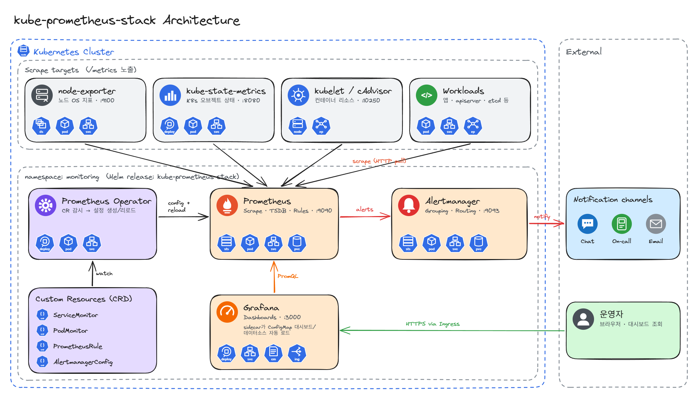

---
### 핵심 컴포넌트

#### Prometheus Operator

- 많은 클라우드 네이티브 OSS들 처럼 `kube-prometheus-stack`은 Prometheus의 여러 하위 컴포넌트들(`ServiceMonitor`, `PrometheusRule` 등)을 관리하기 위해서 Prometheus Operator를 사용한다.
- 컨트롤러(Prometheus Operator) 정의된 CR들을 지속적으로 관리하며 리소스의 상태를 CR과 일시킨다.


#### Prometheus

- 메트릭 수집, 저장, PromQL 쿼리 실행, 알림 룰 평가 하는 역할을 한다.


#### Alertmanager

- Prometheus가 보낸 알림의 그룹핑, 억제, 라우팅 (Slack, 메일, 웹훅 등)


#### Grafana

- 대시보드 시각화
- Prometheus 데이터소스와 기본 대시보드가 사이드카로 자동 프로비저닝된다. (등록하지 않아도 차트 설치하면 기본으로 설치되어있음)

---
### 서브 컴포넌트

#### node-exporter

- DaemonSet으로 배포되어 각 노드의 CPU, 메모리, 디스크, 네트워크 등 OS 메트릭을 노출한다.


#### kube-state-metrics

- K8s API 오브젝트 상태(Deployment replica 수, Pod phase, Job 결과 등)를 메트릭으로 변환


**CRD**

| CRD                          | 역할                                                                                                                                                                                                                                                                                               |
| ---------------------------- | ------------------------------------------------------------------------------------------------------------------------------------------------------------------------------------------------------------------------------------------------------------------------------------------------ |
| Prometheus / Alertmanager    | `values.yaml`에 설정한 Prometheus, AlertManager가 결국 이 CR로 정의된다. <br/> <br/> 그렇다고 Operator만 설치하고 Prometheus와 AlertManager를 별도의 CR로 정의하는 것은 권장되지 않는다. <br/> 왜냐하면 차트가 자동으로 해주는 설정들(셀렉터, SA, RBAC, 기본 룰 등)의 이점을 얻을 수 없기 때문이다. <br/><br/> 참고로 Grafana의 경우 CRD가 없으므로 애초에 `values.yaml`에 지정하는 것 밖에 선택지가 없다. |
| ServiceMonitor               | Service 기준 스크레이프 대상 정의                                                                                                                                                                                                                                                                           |
| PodMonitor                   | Pod 기준 스크레이프 대상 정의                                                                                                                                                                                                                                                                               |
| Probe                        | Blackbox 방식 외부 엔드포인트 점검                                                                                                                                                                                                                                                                          |
| PrometheusRule               | 알림·레코딩 룰                                                                                                                                                                                                                                                                                         |
| AlertmanagerConfig           | 네임스페이스 단위 알림 라우팅                                                                                                                                                                                                                                                                                 |
| ScrapeConfig                 | 정적/외부 대상 스크레이프                                                                                                                                                                                                                                                                                   |
| ThanosRuler, PrometheusAgent | 선택 사용                                                                                                                                                                                                                                                                                            |

> [!info] **기본 제공 CR 설정**
> - **K8s 컴포넌트 ServiceMonitor** 
> 	- kubelet(cAdvisor 포함), apiserver, coreDNS, kube-controller-manager, kube-scheduler, etcd, kube-proxy 스크레이프 설정
> - **기본 PrometheusRule**
> 	- kubernetes-mixin 기반 알림, 레코딩 룰
> - **기본 Grafana 대시보드**
> 	- 클러스터·노드·네임스페이스, Pod 단위 리소스 대시보드
> - **Admission Webhook** 
> 	- PrometheusRule 문법 검증용 Job, Webhook

---
## Prometheus Operator

---
### 역할

> Prometheus Operator는 Prometheus의 설정 파일들을 Kubernetes CRD 로 바꿔서 편리하게 관리할 수 있게 해준다.

일반 Prometheus에서는 `prometheus.yml` 안에 수집 대상, 스크랩 주기, Rule 파일 등을 직접 작성한다. 

그러나, Prometheus Operator를 사용하면 `ServiceMonitor`, `PodMonitor`, `PrometheusRule` 같은 Kubernetes CRD를 만들고 Operator가 이 리소스들을 감시해서 실제 Prometheus 설정을 자동 생성/반영 한다.

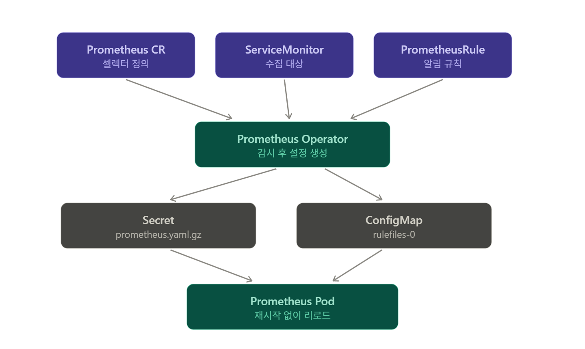


---
### ServiceMonitor

조건을 만족하는 Kubernetes Service를 Prometheus가 수집하도록 하는 리소스

예시

```yaml
apiVersion: monitoring.coreos.com/v1
kind: ServiceMonitor
metadata:
  name: nginx-monitor
  namespace: monitoring

spec:
  selector:
    matchLabels:
      app: nginx

  endpoints:
    - port: metrics
      interval: 30s
```

> [!warning] Selector 가 2단계 있다. (이 관계를 잘 파악해두어야 한다)
> ```
> Prometheus
 >   ↓
> ServiceMonitor 선택
> 
> ServiceMonitor
 >   ↓
> Service 선택
> ```

---
### Prometheus Rule

Prometheus의 Recording Rule과 Alert Rule을 Kubernetes 리소스로 관리하기 위한 CRD

예시

```yaml
apiVersion: monitoring.coreos.com/v1
kind: PrometheusRule

metadata:
  name: node-alerts
  namespace: monitoring

spec:
  groups:
    - name: node-alerts

      rules:
        - alert: HighCPUUsage

          expr: |
            100 -
            (
              avg by(instance) (
                rate(node_cpu_seconds_total{mode="idle"}[5m])
              ) * 100
            ) > 80

          for: 5m

          labels:
            severity: warning

          annotations:
            summary: "Node CPU usage is high"
```

---
### Prometheus Operator CRD의 장점

| 일반 Prometheus    | Prometheus Operator            |
| ---------------- | ------------------------------ |
| `prometheus.yml` | `Prometheus` CR                |
| `scrape_configs` | `ServiceMonitor`, `PodMonitor` |
| `rule_files`     | `PrometheusRule`               |
| 직접 설정 수정         | Kubernetes API에 리소스 생성         |
| IP/SD 설정 직접 관리   | Label Selector 기반              |
| 설정 reload 관리 필요  | Operator가 자동 반영                |
| 하나의 거대한 설정 파일    | 여러 Kubernetes 리소스로 분리          |

> [!info] 가장 큰 장점은 Prometheus 설정도 Kubernetes 리소스처럼 선언적으로 관리할 수 있다는 점이다. (GitOps)

---
## 설치

---
### Helm repo 추가

```bash
helm repo add prometheus-community https://prometheus-community.github.io/helm-charts
helm repo update
```

---
### values.yaml

> Chart Version : `kube-prometheus-stack-92.14.1`

> 현재 클러스터의 SC는 `nfs-subdir-external-provisioner`를 사용하고 있다.

```yaml
prometheus:
  prometheusSpec:
    retention: 2d                        # 메트릭 보관 기간
    retentionSize: 4GB                   # 메트릭 보관 용량
    storageSpec:
      volumeClaimTemplate:
        spec:
          storageClassName: nfs-client   # NFS SC
          accessModes: ["ReadWriteOnce"]
          resources:
            requests:
              storage: 5Gi
    resources:
      requests:
        cpu: 200m
        memory: 512Mi
      limits:
        memory: 1Gi

alertmanager:
  alertmanagerSpec:
    storage:
      volumeClaimTemplate:
        spec:
          storageClassName: nfs-client
          accessModes: ["ReadWriteOnce"]
          resources:
            requests:
              storage: 1Gi
    resources:
      requests:
        cpu: 10m
        memory: 64Mi

grafana:
  adminPassword: "admin123"            # 운영환경에서는 시크릿으로 주입
  persistence:
    enabled: true
    type: pvc
    storageClassName: nfs-client
    size: 1Gi
  deploymentStrategy:
    type: Recreate
  resources:
    requests:
      cpu: 100m
      memory: 128Mi
  initChownData:                      # 특이사항 : 아래 설명 참조
    enabled: false
```

- `initChownData.enabled : false`
	- 이 설정의 default 는 `true` 이다. `true`일 경우 grafana init 컨테이너가 원래 해당 디렉토리를 grafana 유저의 소유로 변경하는 작업을 실행한다.
	- 이 작업이 실행되더라도, NFS export 기본 옵션이 uid 0(root) 로 요청을 보내면 강등시기 때문에, 이러한 소유권 변경이 불가능하다. 이에 오류가 생긴다.
	- 이에 NFS 디렉토리에 적절한 소유권을 주던, 777 권한을 주던 적절한 설정을 직접하고 이 옵션은 `false`로 둔다.

---
### Intsall

설치

```bash
helm install kube-prom-stack prometheus-community/kube-prometheus-stack \
  --version 92.14.1 \
  -n monitoring \
  --create-namespace \
  -f values.yaml
```

확인

```bash
kubectl get pvc -n monitoring
kubectl get pods -n monitoring
```

접속 테스트 (포트포워딩)
- 이후 외부 노출을 ingress로 할지 Gateway API 로 할지는 선택

```bash
kubectl port-forward -n monitoring svc/kube-prom-stack-grafana 3000:80
kubectl port-forward -n monitoring svc/kube-prom-stack-kube-prome-prometheus 9090:9090
```

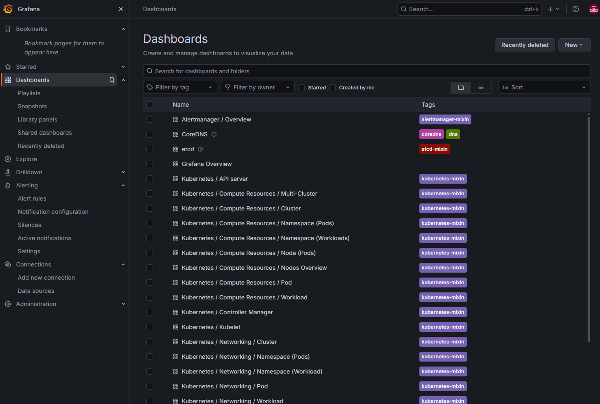

접속해보면, `kube-prometheus-stack`이 생성한기본 대시보드들이 생성되어있는 것을 볼 수 있다.

---
## Thanos

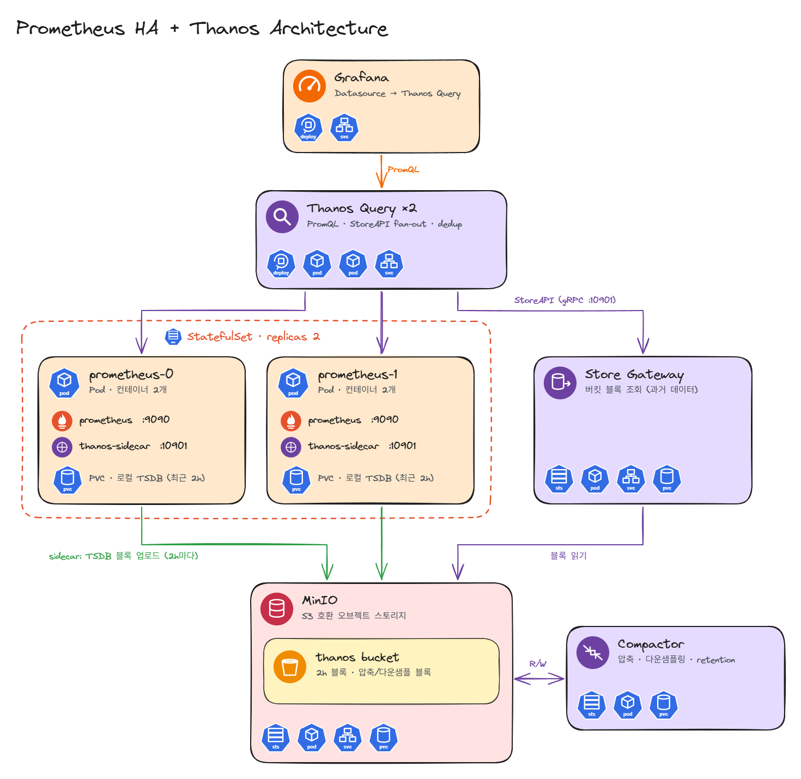

---
### Thanos란?

> Thanos는 Prometheus를 여러 대/여러 클러스터 규모로 확장해서, 장기 보관, 통합, 조회, HA를 가능하게 해주는 계층이다.

기존 Prometheus의 문제점은 단일 인스턴스라는 점이다.각 Prometheus가 로컬 시계열DB에 메트릭을 저장하고, 자기 데이터만 조회하는 구조이다. 따라서 다음과 같은 문제점이 생긴다.

- Prometheus 한 대의 디스크 용량 한계
- 장기 보관 부담
- Prometheus 장애 시 메트릭 조회 불가
- 클러스터가 여러 개면 각각 따로 조회해야 함
- HA를 위해 Prometheus를 2대 띄우면 데이터가 중복됨

Thanos는 위와같은 문제점들을 해결한다.

---
### 구성요소

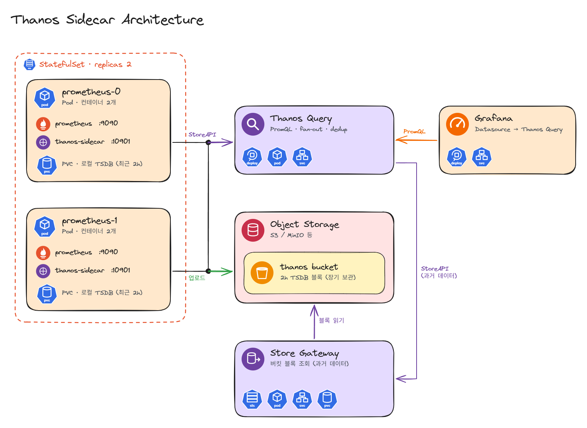

#### Thanos Sidecar

Sidecar는 크게 두 가지 일을 한다.
1. Prometheus의 데이터를 Thanos Query에서 조회할 수 있도록 연결해준다.
2. Prometheus가 만든 시계열DB block을 S3나 MinIO 같은 Object Storage로 업로드한다.
그래서 Prometheus 로컬 데이터가 사라져도 과거 데이터는 Object Storage에 남길 수 있다.

Grafana 입장에서는 최근 데이터는 Prometheus에서 가져오고, 오래된 데이터는 Object Storage에서 가져오는 식으로 동작할 수 있다.


#### Thanos Query

원래는 Grafana가 직접 Prometheus를 본다.

Thanos를 사용하면 위처럼 Thanos Query를 중간에 둔다.

Grafana 입장에서는 Prometheus 하나를 보는 것처럼 사용이 가능하다. PromQL도 그대로 쓴다.


#### Thanos Store Gateway

Object Storage의 데이터를 직접 Grafana가 읽는 것은 아니다.

중간에 `Store Gateway`가 있다.

이에 Thanos Query 입장에서는 Sidecar로는 최신데이터, Store Gateway로는 과거 데이터를 동시에 조회할 수 있다.


#### Thanos Compactor

Object Storage에 계속 Prometheus block을 쌓기만하면 비효율적이므로 Thanos에는 큰 block으로 병합하는 Compactor도 있다.

추가적으로 오래된 데이터를 downsampling하거나 retention 정책에 따라 삭제하는 역할도 한다.

---
### HA 구성에서 Thanos의 장점

예를 들어 Prometheus를 HA로 2개를 띄웠다고 해보자.

둘 다 동일한 ServiceMonitor를 scrape하면 같은 metric을 각각 가지고 있다.

그래서 단순히 데이터를 합치면, 같은 데이터가 두 개씩 나타날 수 있다.

Thanos는 이걸 Deduplicatoin 해준다.

---
### 설치

> Thanos Chart Version : `0.47.2`

---
#### MinIO 배포 및 버킷 구성

> MinIO 이미지는 2025년 하반기부터 사실상 배포가 중단된 상태이다.
> 
> 이에, 나는 프라이빗 레지스트리에 가지고 있던 이미지를 사용했다.
> 
> 각자 알아서 MinIO 이미지를 구해서 아래 이미지 값을 변경해서 사용해야한다.

`minio-thanos.yaml`

```yaml
apiVersion: v1
kind: Secret
metadata:
  name: minio-root
  namespace: monitoring
type: Opaque
stringData:
  MINIO_ROOT_USER: minioadmin        # 운영에서는 시크릿
  MINIO_ROOT_PASSWORD: minioadmin123
---
apiVersion: v1
kind: PersistentVolumeClaim
metadata:
  name: minio-data
  namespace: monitoring
spec:
  accessModes: ["ReadWriteOnce"]
  storageClassName: nfs-client
  resources:
    requests:
      storage: 20Gi
---
apiVersion: apps/v1
kind: Deployment
metadata:
  name: minio
  namespace: monitoring
spec:
  replicas: 1
  strategy:
    type: Recreate
  selector:
    matchLabels:
      app: minio
  template:
    metadata:
      labels:
        app: minio
    spec:
      containers:
      - name: minio
        image: offline.k8s.registry:5000/pgsty/minio:RELEASE.2026-08-04T00-00-00Z
        args: ["server", "/data", "--address", ":9000", "--console-address", ":9001"]
        envFrom:
        - secretRef:
            name: minio-root
        ports:
        - name: api
          containerPort: 9000
        - name: console
          containerPort: 9001
        readinessProbe:
          httpGet:
            path: /minio/health/ready
            port: 9000
        livenessProbe:
          httpGet:
            path: /minio/health/live
            port: 9000
        volumeMounts:
        - name: data
          mountPath: /data
      volumes:
      - name: data
        persistentVolumeClaim:
          claimName: minio-data
---
apiVersion: v1
kind: Service
metadata:
  name: minio
  namespace: monitoring
spec:
  selector:
    app: minio
  ports:
  - name: api
    port: 9000
  - name: console
    port: 9001
---
apiVersion: networking.k8s.io/v1
kind: Ingress
metadata:
  name: minio-console
  namespace: monitoring
  annotations:
    nginx.org/websocket-services: "minio"
    nginx.org/proxy-read-timeout: "3600s"
    nginx.org/proxy-send-timeout: "3600s"
    nginx.org/client-max-body-size: "0"
spec:
  ingressClassName: nginx
  rules:
  - host: minio.thanos.local
    http:
      paths:
      - path: /
        pathType: Prefix
        backend:
          service:
            name: minio
            port:
              number: 9001
```


접속 후 로그인하면 아래와 같은 화면을 볼 수 있다.

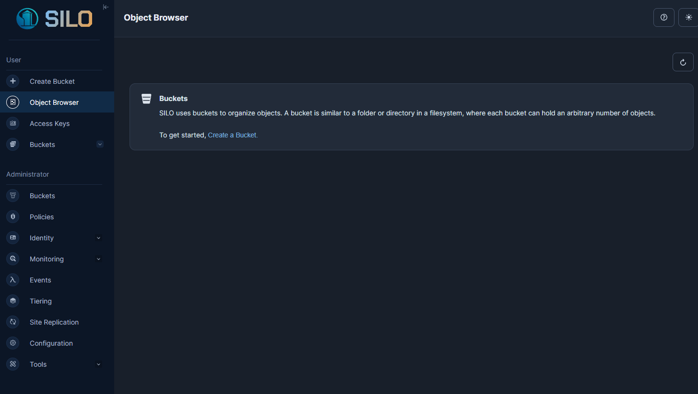


여기서 Bucket 메뉴에서 `thanos` 버킷을 생성한다.
- Create Bucket
	- Bucket Name : `thanos`
	- 나머지 옵션 디폴트로 놔두고 'Create Bucket'

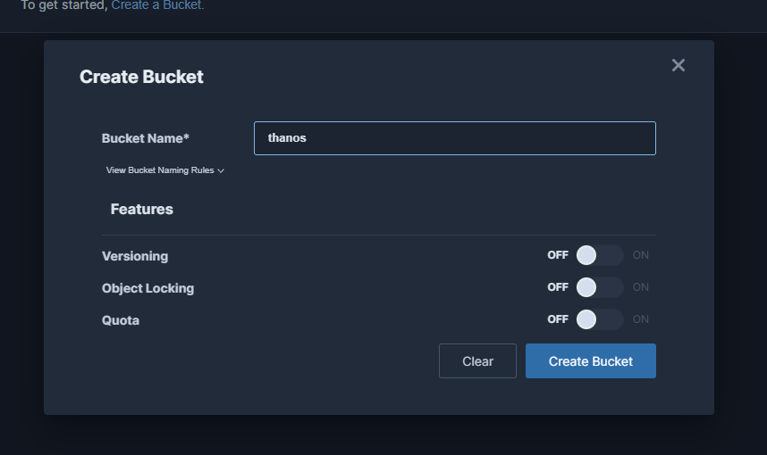

---
#### Thanos Object Storage 설정 Secret 생성

Thanos에게 내 Object Storage는 저 MinIO라고 알려줘야한다.

Thanos는 S3-compatible storage를 지원하며 최소한 `bucket`, `endpoint`, `access_key`, `secret_key` 설정이 필요하다.

아래 설정은 실습을 위한 것이고 운영 환경에서는 당연히 이렇게 자격 증명을 평문으로 남겨두면 안된다. 추가적으로 TLS 도 사용해야한다.

```yaml
apiVersion: v1
kind: Secret
metadata:
  name: thanos-objstore
  namespace: monitoring
type: Opaque
stringData:
  objstore.yml: |
    type: S3
    config:
      bucket: thanos
      endpoint: minio.monitoring.svc:9000
      access_key: minioadmin
      secret_key: minioadmin123
      insecure: true
```


---
#### kube-prometheus-stack values.yaml 수정

1. Prometheus HA구성
	- `kube-prometheus-stack` 의 `values.yaml`의 `prometheus.prometheusSpec` 바로 하위에 `replicas: 2`를 넣는다.

```yaml
prometheus:
  prometheusSpec:
    replicas: 2
    
    ...
```


2. Thanos Sidecar 붙이기 & 기타 설정

```yaml
prometheus:
  thanosService:
    enabled: true    # Thanos Query가 Sidecar discovery 하기 위한 서비스 생성
  thanosServiceMonitor:
    enabled: true    # sidecar 메트릭 수집
  prometheusSpec:
    replicas: 2

    retention: 2d
    retentionSize: 4GB
    


    thanos:
      image: quay.io/thanos/thanos:v0.42.4

      objectStorageConfig:
        existingSecret:
          name: thanos-objstore
          key: objstore.yml
```


```bash
helm upgrade kube-prom-stack prometheus-community/kube-prometheus-stack \
  --version 92.14.1 \
  -n monitoring \
  -f values.yaml
```

---
#### Thanos 차트용 values.yaml 작성 및 설치

현 실습은 sidecar 방식이므로 receive 옵션을 꺼주었다. 두 방식의 차이는 아래와 같으며, 현 실습에서 sidecar 방식을 선택한 이유는 **단일 클러스터 안에서 Query가 Prometheus에 직접 접근할 수 있으니, Receive를 따로 운영할 필요 없이 Prometheus Pod에 컨테이너 하나만 붙이는 Sidecar가 가장 단순하고 리소스도 적게 들어서 선택했다.**

|구분|Sidecar|Receive|
|---|---|---|
|데이터 흐름|Query가 Prometheus에서 가져감 (pull)|Prometheus가 Receive로 보냄 (push, `remote_write`)|
|최근 데이터 위치|Prometheus 로컬|Receive 로컬|
|오브젝트 스토리지 업로드|Sidecar가 2시간 블록 업로드|Receive가 2시간 블록 업로드|
|추가 컴포넌트|없음 (Prometheus Pod에 컨테이너 추가)|Receive StatefulSet, PVC|
|리소스 사용|적음|많음 (특히 메모리)|
|운영 난이도|낮음|높음 (hashring, 복제 관리)|
|중복 제거 라벨|`prometheus_replica`|`receive_replica`|
|적합한 환경|단일 클러스터, Query가 Prometheus에 직접 접근 가능|멀티 클러스터·엣지 환경, 중앙에서 Prometheus에 접근 불가, 멀티 테넌트|

```yaml
global:
  # 폐쇄망이면 프라이빗 레지스트리로 변경
  # image:
  #   registry: offline.k8s.registry:5000
  #   repository: thanos/thanos
  objstore:
    createSecret: false            # 이미 만든 Secret 사용
    secretName: thanos-objstore
    secretKey: objstore.yml

# 사이드카 방식이므로 Receive는 끔 (차트 기본값이 true라서 반드시 명시)
receive:
  enabled: false

ruler:
  enabled: false                   # 기본값도 false

query:
  enabled: true
  replicaCount: 2
  replicaLabels:
    - prometheus_replica           # HA Prometheus 중복 제거 기준 (기본값에 이미 포함)
  endpoints:
    autogen:
      enabled: true                # 차트 안의 Store Gateway는 자동 등록
    static:
      - dnssrv+_grpc._tcp.kube-prom-stack-kube-prome-thanos-discovery.monitoring.svc.cluster.local

storegateway:
  enabled: true
  persistence:
    storageClass: nfs-client
    size: 10Gi

compactor:
  enabled: true                    # replica는 반드시 1
  persistence:
    storageClass: nfs-client
    size: 10Gi
  retention:
    resolutionRaw: 30d
    resolution5m: 90d
    resolution1h: 365d
```


```bash
helm install thanos oci://ghcr.io/thanos-community/helm-charts/thanos \
  --version 0.47.2 -n monitoring -f values.yaml
```

---
#### Grafana 연동

kube-prometheus-stack 의 `values.yaml` 수정

```yaml
grafana:
  sidecar:
    datasources:
      isDefaultDatasource: false     # 기본 Prometheus 데이터소스를 default에서 해제
  additionalDataSources:
    - name: Thanos
      type: prometheus
      url: http://thanos-query.monitoring.svc:9090
      access: proxy
      isDefault: true
```

```bash
helm upgrade kube-prom-stack prometheus-community/kube-prometheus-stack \
  --version 92.14.1 \
  -n monitoring \
  -f values.yaml
```

---
#### 확인

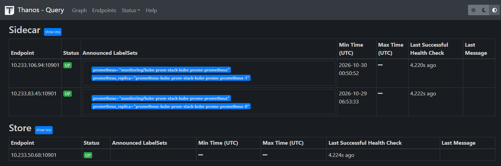

1. Query 연결 확인: `kubectl port-forward svc/thanos-query 9090:9090 -n monitoring`로 연결한 뒤 Query UI의  Endpoints 탭을 연다. sidecar 2개와 Store Gateway 1개가 모두 UP이면 정상이다.

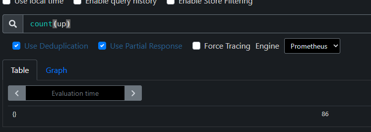

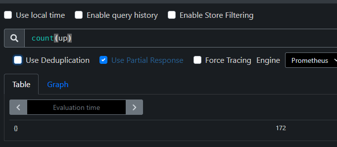

2. 중복 제거 확인: 쿼리 화면에서 `count(up)` 쿼리 입력하고 deduplication 체크박스를 켜고 끄면서 결과를 비교한다. 켰을 때 시계열이 반으로 줄면 정상이다.

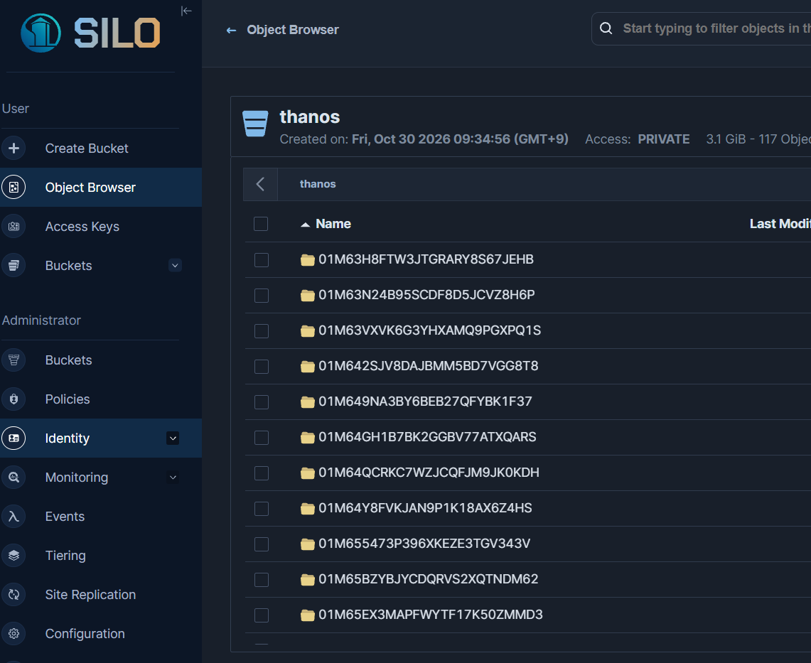

3. 업로드 확인: 약 2시간 뒤 MinIO 콘솔의 `thanos` 버킷에 블록(ULID 디렉터리)이 올라오는지 봅니다. Prometheus 블록 단위가 2시간이라 바로 보이지는 않습니다.


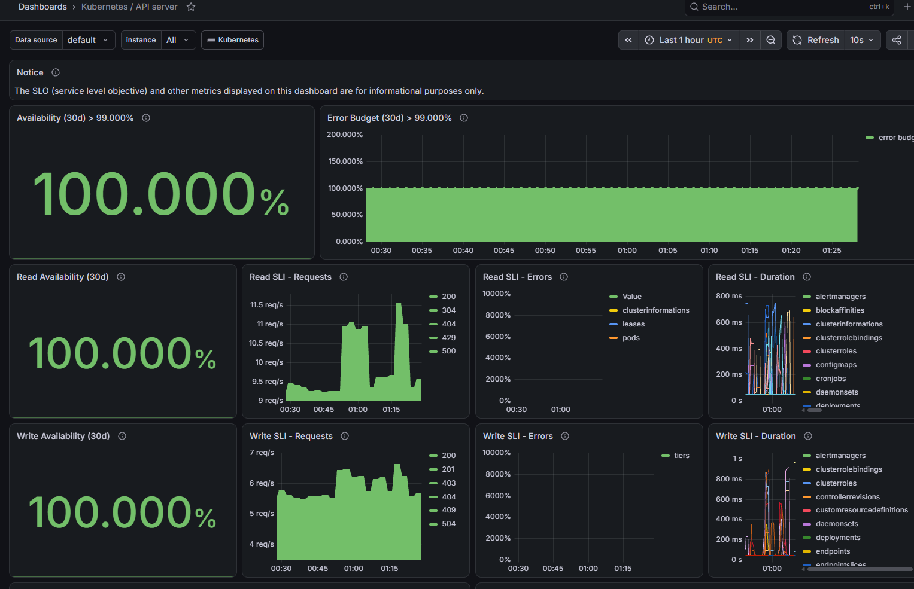

4. Grafana 확인: Thanos 데이터소스로 기존 대시보드가 정상 표시되는지 본다.

---
